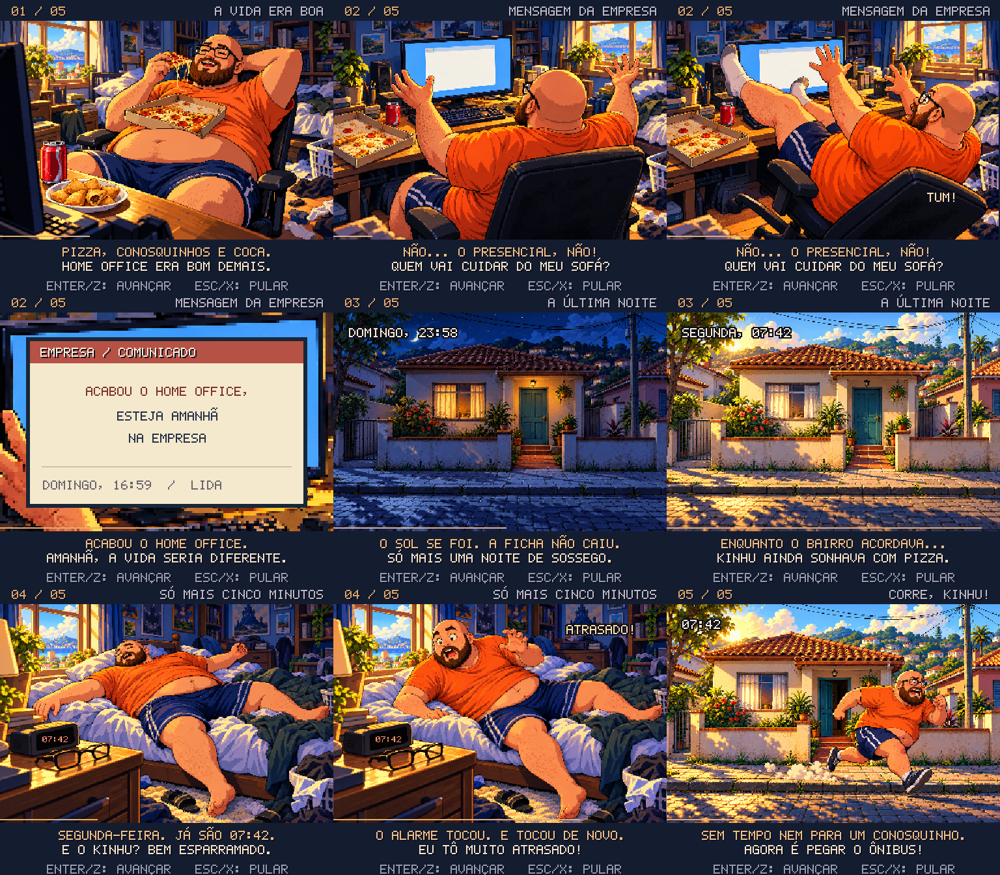
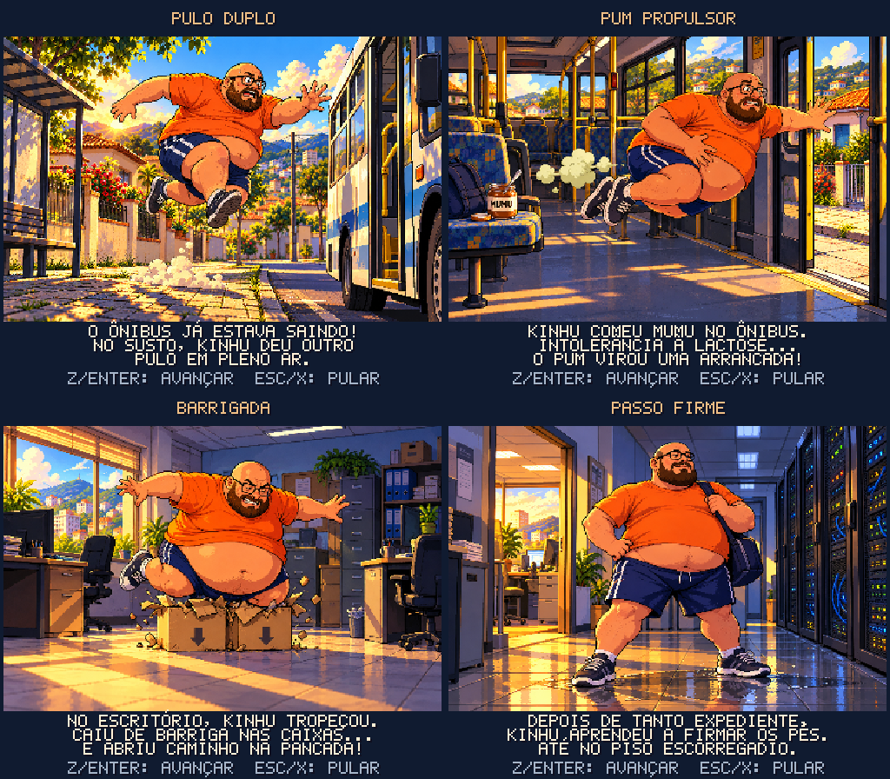

# Kinhu's Adventure

Jogo de plataforma em pixel art no estilo Super Nintendo, feito com HTML, CSS e JavaScript puros: sem frameworks, sem build e sem dependências. Roda direto no navegador e pode ser publicado de graça no **GitHub Pages**.


Pizza na barriga, conosquinhos e Coca: o home office do Kinhu era tranquilo demais. Até chegar a mensagem: **"ACABOU O HOME OFFICE, ESTEJA AMANHÃ NA EMPRESA"**. Segunda-feira, 07:42: o alarme toca e ele continua esparramado na cama. Ajude o Kinhu a pegar o ônibus, atravessar o centro da cidade e sobreviver a um dia de escritório, até enfrentar o **MEGA BUG** na sala dos servidores.

## Abertura em cutscenes

Ao escolher **NOVO JOGO**, uma sequência de cerca de 45 segundos apresenta a história em cinco cenas de pixel art, com oito ilustrações, poses expressivas, cortes entre quadros, movimentos de câmera, música e efeitos. A direção visual segue as aberturas ilustradas de aventuras dos anos 1990. A arte usa 384×256 pixels, apresentada em canvas de 768×672; o gameplay mantém 256×224.



1. Kinhu come pizza com a caixa apoiada na barriga, no quarto bagunçado e ensolarado, até receber uma notificação.
2. Visto por trás, ergue os braços em desespero e cai com a cadeira. A câmera se aproxima da mensagem na tela.
3. A noite cai sobre a casinha e o dia amanhece.
4. Kinhu dorme esparramado, enquanto o despertador marca **07:42**, até perceber o atraso.
5. Sai correndo pela porta.

A abertura original leva diretamente à primeira fase, sem falar dos poderes. Ao concluir cada uma das quatro primeiras fases, surge **uma cena individual de aquisição**, com sua própria imagem e apenas a origem daquela habilidade. Cada cena dura cerca de 13 segundos, seguida da introdução da próxima fase. O comando aparece na segunda legenda; demonstrações ficam em **GUIA DO JOGO → HABILIDADES / COMO USAR**, navegáveis com as setas.



**Enter, Espaço ou Z** avançam uma cena/legenda; **Esc ou X** pulam. No controle, **A** avança e **Start/B** pula. No celular, toque na tela ou em **A** para avançar, **Start/B** para pular. As cenas avançam sozinhas e congelam ao ocultar a aba. **CONTINUAR** retoma apenas uma aquisição interrompida. Depois de vista ou pulada, a cena não se repete após morte, checkpoint ou retomada; não há replay narrativo no menu. Saves antigos não exibem retrospectivamente poderes já adquiridos.

| | |
|---|---|
|  |  |
|  |  |

## Fases

1. **Saindo de Casa** (07:42): calçada de pedra portuguesa, cachorros caramelo, pombos, baratas, muro com caco de vidro, córrego e uma rua com carros. Termina no ponto de ônibus, e o ônibus chega para buscar o Kinhu.
2. **Viagem de Ônibus** (07:55): dentro do ônibus lotado. Bancos, bagageiros, passageira com bolsa, trombadinha que rouba moedas e as **freadas**, **arrancadas** e **lombadas**, que empurram todo mundo.
3. **Centro da Cidade** (08:20): bueiros abertos, hidrante que espirra água, obra com peso de 1 tonelada caindo, tábuas que despencam, avenida movimentada e skatistas.
4. **O Escritório** (09:00): mesas, arquivos, impressoras que atiram papel, colegas estressados jogando aviãozinho, estagiário correndo com café, chão molhado, tachinhas, elevadores e bugs.
5. **Sala dos Servidores** (16:59): faíscas, água eletrificada e a luta contra o **MEGA BUG**.

Os percursos foram ampliados novamente com novos obstáculos e inimigos: as quatro primeiras fases têm **680 blocos de largura** (antes, 424), e a Sala dos Servidores tem **424** (antes, 232). No modo normal, todas começam com **900 no cronômetro**. Os checkpoints ficam próximos da metade das fases comuns e antes da arena final. No modo normal, o **MEGA BUG tem 24 pontos de vida**, o dobro do original, e entra em fúria ao chegar a 12.

## Dificuldade

Em **CONFIGURAÇÕES → JOGABILIDADE → DIFICULDADE**, no menu inicial ou na pausa, escolha:

| Modo | Tentativas | Tempo | Desafio |
|---|---:|---:|---|
| **Kinhu** | 9 | 1500 | Sem inimigos ou chefe; pegue o troféu no final. |
| **Fácil** | 5 | 1200 | Inimigos mais lentos, ataques menos frequentes e chefe com 16 de vida. |
| **Normal** | 3 | 900 | Ritmo original e chefe com 24 de vida. |
| **Difícil** | 2 | 750 | Inimigos mais rápidos, ataques mais frequentes e chefe com 32 de vida. |

Todos começam com três corações. **Kinhu mantém os perigos do cenário**, como buracos, líquido, espinhos, pesos e trânsito. A preferência fica salva neste navegador e vale para novo jogo e replay. **CONTINUAR** mantém o modo salvo na campanha. Trocar na pausa reinicia a fase/ponto com as tentativas e corações do novo modo; habilidades e coletáveis já consumidos são preservados, e os bônus temporários acabam.

## Controles

Em **CONFIGURAÇÕES → CONTROLES**, no menu inicial ou na pausa, escolha um conjunto de teclado. A estrela indica o conjunto ativo; a prévia mostra os comandos antes de selecionar. A preferência fica salva neste navegador e não altera a campanha ou os arquivos de save. Dicas, HUD, cenas e ajuda mostram as teclas escolhidas.

| Conjunto | Movimento | Pular | Correr / latas | Pum |
|---|---|---|---|---|
| Clássico | Setas (WASD também funciona) | Z / Espaço / ↑ (K e W também funcionam) | X / Shift (J também funciona) | C |
| WASD + J/K/L | WASD ou setas | J / Espaço | K / Shift | L |
| WASD + Espaço/Shift/E | WASD ou setas | Espaço | Shift | E |

Nos conjuntos WASD, **W não aciona pulo**. Barrigada: **S + novo toque em pular no ar**; descida de plataforma: **S + pular quando estiver apoiado**. Pulo duplo exige soltar e apertar novamente. **Enter/Esc** pausa; **M** alterna som; **F** alterna tela cheia. Navegue nos menus com **W/S ou ↑/↓**, confirme com **Enter** (ou a tecla de pulo do conjunto) e volte com **Esc**.

No controle, os comandos continuam: direcional/analógico para andar, **A** para pular, **B/X** para correr/latas, **RB** para pum, **baixo + A** para barrigada/descida e **Start** para pausa. No celular: **A**, **B**, **C**, direcional e **START**. Passo firme é passivo em todos os dispositivos.

**Celulares e tablets** são identificados pela capacidade de toque; o primeiro toque também ativa os controles em aparelhos híbridos. Em retrato, os botões ficam abaixo do jogo; em paisagem, nas laterais, respeitando as áreas seguras da tela. **A** pula/confirma, **B** corre/lança latas/volta e **START** pausa. **C** aparece quando o pum está disponível. É possível segurar direção + B + A ao mesmo tempo e deslizar o dedo entre as setas. Para o pulo duplo, solte A e toque novamente. Configurações e tela cheia continuam acessíveis; tela cheia depende do suporte do navegador. Usar um teclado não remove os botões de toque.

## Itens

- **Moeda**: 200 moedas dão uma vida extra; a contagem continua entre fases e fica salva.
- **Cachorro-quente**: recupera um coração.
- **Lata de Coca-Cola**: o Kinhu fica de camiseta vermelha e pode arremessar latas com o botão de corrida. Sem mochila, um golpe remove a Coca antes dos corações. Segure o botão de pulo para alcançar os itens sobre os blocos.
- **Café expresso**: +15% na aceleração e velocidade máxima por 8 segundos, sem aumentar a altura do pulo. Introduzido na reta inicial do centro.
- **Mochila acolchoada**: absorve um golpe comum antes da Coca-Cola e dos corações. Não protege contra queda, líquido ou esmagamento fatal. Introduzida no ônibus.
- **Ímã de troco**: atrai somente moedas até três blocos por 12 segundos, respeitando paredes. Aparece primeiro em um trecho opcional do bairro.
- **Garras**: ativa o **modo Kinhurine**. Uma cena ilustrada de **4 segundos** mostra a energia se acumulando, três garras metálicas surgindo de cada punho e o grito enfurecido. A música muda para uma trilha de tensão, com som metálico nas garras e um grito sintetizado na pose final; a trilha baixa durante o grito. Depois entra o tema acelerado do poder. O cabelo arrepia e o Kinhu ganha **10 segundos de invencibilidade**. Mundo e poder ficam congelados durante a cena; Z, Enter, A do controle ou toque permitem pular.
- **Crachá 1UP**: vida extra rara, disponível apenas no Centro e no Escritório, um por fase.
- **Relógio de ponto**: é o checkpoint ("bateu o ponto!"). Se morrer, você volta dali.

Coca-Cola, mochila e café **ou** ímã podem coexistir. Café e ímã se substituem; repetir o mesmo item renova sua duração. Kinhurine suspende os efeitos e contadores dos utilitários, preservando a mochila. HUD indica tempo restante, `!` nos últimos dois segundos e **PAUSA** durante Kinhurine. **GUIA DO JOGO → ITENS / COMO USAR** explica as regras.

Morte, mudança de fase, reinício e retomada removem café, ímã e mochila. Coletáveis fixos consumidos não reaparecem na mesma fase ao recarregar; novo jogo ou replay reinicia a coleta. No normal, o jogo começa com **3 tentativas e 3 corações**. Um combo de nove pisões seguidos concede uma única vida extra; os pisões seguintes do mesmo combo rendem pontos.

## Salvamento

- **Automático (cache do navegador)**: o jogo salva sozinho no `localStorage` ao começar cada fase, ao consumir coletáveis fixos, ao bater o ponto e ao terminar uma fase. Na tela inicial aparece **CONTINUAR**.
- **Arquivo de save (.json)**: na pausa ou na tela inicial, entre em **ARQUIVOS DE SAVE → BAIXAR ARQUIVO DE SAVE**. É baixado um arquivo como `kinhus-adventure-save-20261007-0915.json`.
- **Carregar em outro lugar**: em outro computador ou navegador, use **ARQUIVOS DE SAVE → CARREGAR ARQUIVO DE SAVE** e escolha o arquivo, ou simplesmente **arraste o arquivo para a página**. O jogo continua de onde você parou.
- O arquivo tem uma soma de verificação: se for corrompido ou editado à mão, o jogo recusa e avisa.
- O save usa o **formato 5** e migra automaticamente arquivos e dados do navegador nos formatos 1, 2, 3 e 4, preservando fase, checkpoint, Coca-Cola, corações, moedas e recordes. Saves v1–v3 usam dificuldade normal; v4 preserva a dificuldade. Modo, assistência, consumo de itens e dados dos desafios ficam salvos; mochila, café e ímã não são restaurados. Coleção e desafios ficam separados da campanha. Importar une lembranças e melhores recordes dos dois saves.
- **ESCOLHER FASE** inicia uma partida de replay que preserva a campanha salva. O replay pode melhorar o recorde; baixar o save durante ele exporta a campanha preservada. **CONTINUAR** retoma essa campanha.

As quatro habilidades estão ativas e persistem após dano, morte e retomada. Novo jogo reinicia os poderes. **Pulo duplo:** um impulso extra por pouso. **Pum:** três blocos horizontais, recarga de um segundo e um uso aéreo até pousar, sem dano ou invencibilidade. **Barrigada:** baixo + novo toque em pular no ar; quebra só caixas marcadas com ▼ e aciona botões de chão. Não quebra estruturas nem substitui a descida de plataformas. **Passo firme:** reduz recuo em 30% e deslizamento em cerca de 30%, sem proteger de água eletrificada. O início do ônibus, centro, escritório e servidores oferece prática segura para a habilidade correspondente. Etapas 1–5 concluídas; próxima entrega: expansão opcional, conforme o [plano de melhorias](PLANO-MELHORIAS.md).

## Exploração, replay e conforto

Há **três lembranças por fase**: postal, bilhete e disquete, em rotas opcionais que retornam ao caminho principal. A estrela identifica uma lembrança nova; `O` e desenho discreto indicam uma já guardada. A primeira coleta concede 500 pontos. Coleção é permanente, inclusive após morte, novo jogo ou replay; recoletar não duplica pontos.

**ESCOLHER FASE** mostra coleção, poderes disponíveis, desafios e melhor tempo. Replay preserva a campanha e pode completar a coleção. Na pausa, **GUIA DO JOGO → EXPLORAÇÃO / DESAFIOS** explica as metas e mostra tempo ativo e mortes. Os três desafios são independentes: concluir sem morrer, recolher as três lembranças na partida ou concluir em até **5 minutos** nas fases 1–4/**4 minutos** na última. Pausa, cutscenes e aba oculta não contam. Recordes ficam separados por dificuldade e assistência; as metas são iniciais. Saves antigos precisam iniciar uma nova fase/replay para desafios de tempo e mortes, pois não têm esse histórico.

Em **CONFIGURAÇÕES → ACESSIBILIDADE**, configure redução de tremor e redução de flashes. Em **CONFIGURAÇÕES → ÁUDIO**, ajuste os volumes independentes de música e efeitos com esquerda/direita ou Enter. Preferências ficam salvas no navegador. Com flashes reduzidos, Kinhu permanece visível durante a proteção após dano, indicada por `O`; as regras de dano permanecem iguais. Plataformas antes de cair e emissores antes do disparo mostram `!`.

**Assistência**, em **CONFIGURAÇÕES → JOGABILIDADE**, acrescenta 50% ao tempo inicial e permite morrer após o checkpoint sem gastar tentativa; antes de bater o ponto, a tentativa ainda é consumida. Não concede poderes futuros. No título vale para novo jogo/replay; **CONTINUAR** mantém a assistência salva. Trocar na pausa reinicia do ponto, remove os itens temporários e desabilita desafios de tempo/sem mortes naquela fase. Coleção e desafios de exploração continuam disponíveis.

## Menus

Os menus inicial e de pausa têm até seis entradas. **CONFIGURAÇÕES** reúne controles, jogabilidade, áudio e acessibilidade; **ARQUIVOS DE SAVE** reúne importação e exportação; **GUIA DO JOGO** reúne comandos, habilidades, itens e exploração. A opção selecionada recebe destaque e uma descrição. Navegue pelo teclado, controle, mouse ou toque; **Esc/B** ou **VOLTAR** retorna ao menu anterior mantendo a seleção.

Abaixo da tela ficam **Configurações** e **Tela cheia**. Abrir configurações durante uma partida pausa o jogo.

## Publicar no GitHub Pages (grátis)

O projeto já está pronto como repositório Git local (branch `main`). Para publicar:

1. Entre em [github.com/new](https://github.com/new) e crie um repositório **público** chamado `kinhus-adventure`, sem README, sem .gitignore e sem licença.
2. Nesta pasta, rode (troque `SEU-USUARIO` pelo seu usuário do GitHub):

   ```bash
   git remote add origin https://github.com/SEU-USUARIO/kinhus-adventure.git
   ```

   ```bash
   git push -u origin main
   ```

3. No GitHub, abra **Settings → Pages**. Em **Build and deployment**, escolha **Source: Deploy from a branch**, branch **main**, pasta **/ (root)** e clique em **Save**.
4. Depois de um ou dois minutos o jogo estará em:

   `https://SEU-USUARIO.github.io/kinhus-adventure/`

Sem usar Git: crie o repositório, clique em **Add file → Upload files**, arraste todo o conteúdo desta pasta (menos `.git`) e siga a partir do passo 3.

## Jogar localmente

Dá para abrir o `index.html` direto no navegador (duplo clique).

Também existe a versão em **arquivo único**: `dist/kinhus-adventure.html` (cerca de 5,6 MB, com tudo embutido, incluindo as cutscenes). Dá para mandar esse arquivo por e-mail ou WhatsApp e abrir em qualquer navegador, mesmo sem internet. Depois de mudar o código, gere de novo com:

```bash
node tools/bundle.js
```

Se preferir um servidor local:

```bash
python -m http.server 8765
```

Depois acesse `http://localhost:8765`.

## Estrutura

```
index.html          página do jogo (256×224 no gameplay; 768×672 nas cutscenes)
css/style.css       moldura, barra de opções e controles de toque
js/core.js          tela, entrada (teclado/controle/toque), fonte bitmap, ferramentas de pixel art
js/mobile.js        detecção de toque, multitoque, arraste no direcional e liberação dos botões
js/progression.js   marcos da campanha, catálogo de habilidades, roteiro e feedback
js/sprites.js       Kinhu, inimigos, itens e projéteis (pixel art desenhada em código)
js/world.js         temas, blocos, fundos com parallax, decoração, carros, ônibus, prédios
js/audio.js         sintetizador chiptune com eco estilo SNES, músicas e efeitos
js/levels.js        mapas das 5 fases (texto: cada caractere é um bloco de 16×16)
js/settings.js     quatro dificuldades, bônus temporários e consumo dos coletáveis
js/exploration.js  coleção, desafios, replay, assistência e preferências de conforto
js/save.js          salvamento no navegador e arquivo de save .json
js/game.js          física, Kinhu, inimigos, itens, chefe, chegada nas fases
js/main.js          telas, menus, HUD, transições e laço principal (60 fps fixos)
js/title.js         tela de título: logo em pixel art com relevo e cena animada
js/cutscenes.js     abertura em cinco cenas: arte em camadas, animações, legendas e câmera
js/origin.js        quatro origens: imagens individuais, legendas e retomada da aquisição
js/introart.js      carregamento e apresentação das novas ilustrações, câmera e texto sobreposto
js/kinhurine.js     transformação de 4 segundos ao coletar garras; retoma a mesma fase
assets/cutscenes/   abertura, Kinhurine e quatro origens, versões leves e prompts
tools/              ferramentas de desenvolvimento em Node (não são necessárias para jogar)
```

### Editando fases

Cada fase em `js/levels.js` é uma lista de segmentos com 14 linhas cada. A legenda completa está no topo do arquivo: `#` chão, `?` bloco de moeda, `c` moeda, `d` cachorro, `C` relógio de ponto, `G` chegada e assim por diante.

### Ferramentas (opcional, precisa de Node.js)

```bash
node tools/bot.js all
```

O robô de teste tenta zerar cada fase segurando "direita" e pulando obstáculos; use `inv` para ignorar dano.

```bash
node tools/test.js tools/out
```

Gera prints de todas as fases sem abrir o navegador. `tools/sheet.js`, `tools/scenes.js` e `tools/make-assets.js` geram folhas de sprites, cenas especiais, o ícone e os prints deste README.

`node tools/test-cutscenes.js` valida a abertura automática, os controles, o reinício, a pausa em aba oculta e a continuidade de saves; também gera `tools/out/cutscenes-storyboard.png` para conferir os enquadramentos.

`node tools/test-cutscenes.js --bundle` executa os mesmos testes no HTML offline, incluindo as oito imagens embutidas. Os testes também cobrem a troca de resolução, a espera pelo carregamento e o modo simples de segurança se uma imagem faltar. `node tools/prepare-cutscenes.js` regenera os PNGs leves em 384×256 a partir dos originais; depois rode o bundle novamente.

`node tools/test-kinhurine.js` testa a coleta real, o congelamento do mundo e do poder, retorno sem recarga, nova coleta, skip, aba oculta, saves e falha de carregamento das imagens. Acrescente `--bundle` para validar o HTML offline. Prévia: `assets/screens/07-kinhurine.png`. Direção de arte e prompts: `assets/cutscenes/KINHURINE-ART.md`.

`node tools/test-pickups.js` valida a altura dos pulos curto e longo e a coleta por pulo das latas em todos os blocos de bebida, além do arremesso e da perda do poder ao receber dano. Acrescente `--bundle` para testar o HTML offline.

`node tools/test-levels.js` valida as dimensões dos mapas ampliados, checkpoints, tempo, entrada na arena, vida e fúria do chefe, criação do troféu e equilíbrio das vidas extras (moedas, saves e combos). Acrescente `--bundle` para testar o HTML offline.

`node tools/test-progression.js` valida migração v1/v2/v3, checksum original, armazenamento local, marcos da campanha, conclusão sem duplicação, morte, novo jogo, retomada, preservação do save durante replay e comandos C/RB/toque. Também confere a largura das legendas e do feedback preparados. Acrescente `--bundle` para testar o HTML offline. Regras das cenas individuais: `assets/cutscenes/ORIGEM-PODERES.md`.

`node tools/test-double-jump.js` testa aquisição do pulo duplo com teclado/gamepad/toque, retomada, impulso extra único, tetos, plataformas móveis, descida, coleta nos bagageiros e prática sem freada. Cobre ajuda na pausa, fallback e saves antigos. Acrescente `--bundle` para a versão offline.

`node tools/test-mobility.js` testa os três novos poderes nos três dispositivos: alcance, recarga, limites aéreos, paredes, dano, combinações de movimentos, caixas, botões, descida de plataformas, passo firme, inimigos e intervalo de dano no chefe. Testa as quatro cenas na ordem da campanha e gera prévias em `tools/out/`. Acrescente `--bundle` para o HTML offline.

`node tools/bot.js all inv noitems` percorre os cinco cenários com as habilidades correspondentes, sem Coca-Cola/Kinhurine/mochila/café/ímã. `inv` ignora golpes comuns para isolar geometria e alcance; queda e líquido continuam fatais. Este teste não mede dificuldade ou conforto dos controles físicos. Os testes de dano e limites dos poderes são separados.

As quatro novas imagens foram produzidas com ImageGen integrado, com a abertura original como referência. Prompts: [PROMPTS-PODERES.md](assets/cutscenes/PROMPTS-PODERES.md). Regras de apresentação: [ORIGEM-PODERES.md](assets/cutscenes/ORIGEM-PODERES.md).

`node tools/test-controls.js` verifica os três conjuntos, seleção no menu, persistência, dicas, movimento, pulo duplo, pum, barrigada, latas e compatibilidade de gamepad/toque, preservando o save. Acrescente `--bundle` para validar o HTML offline.

`node tools/test-mobile.js` verifica detecção de celular/tablet/desktop, ativação pelo primeiro toque, múltiplos dedos, arraste no direcional, pulo duplo, toques rápidos, cancelamento e liberação ao perder foco, ocultar a aba ou girar a tela. Acrescente `--bundle` para validar o HTML offline.


`node tools/test-items-difficulty.js` testa duração, renovação/troca, coexistência, dano e perigos fatais, física do café, raio/parede do ímã, congelamento, consumo persistente e migração v3→v4. Verifica os quatro modos, parâmetros de inimigos/ataques/chefe, conclusão no Kinhu, menus, preferências, retomada e replay. Acrescente `--bundle` para o HTML offline. Gera prévias em `tools/out/`.

`node tools/test-exploration.js` verifica acesso às 15 lembranças usando saltos reais, coleção permanente, recompensa única, retomada, replay preservando campanha, desafios independentes, categorias por modo/assistência, congelamento do tempo, migração v4→v5, união/validação de perfis, assistência no checkpoint, volumes e opções visuais. Gera prévias de menus e exploração. Acrescente `--bundle` para o HTML offline.

`node tools/test-menus.js` verifica categorias, navegação e retorno com seleção preservada, cliques e áreas de toque, acesso aos saves, prévias sem texto cortado e pausa durante os submenus. Gera prévias `tools/out/gui-*.png`. Acrescente `--bundle` para o HTML offline.
